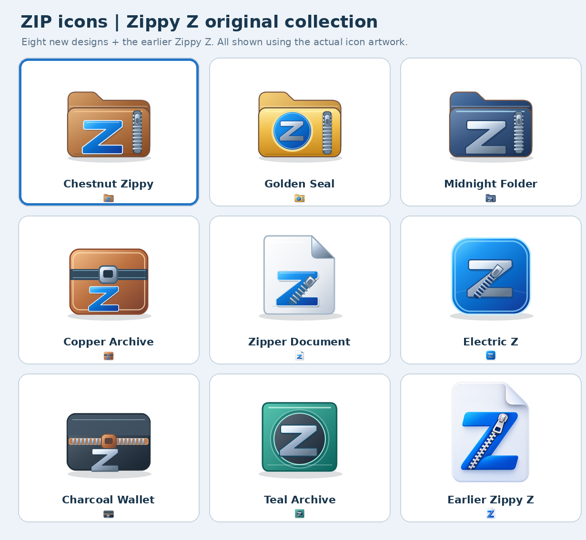

# Zippy Z — Windows ZIP Icon Chooser

**Created and maintained by Mark McEnarney**  
Copyright (c) 2026 Mark McEnarney · MIT Licence

Fed up with ZIP files looking almost identical to ordinary folders in Windows 11?

**Zippy Z** gives your compressed files a distinctive identity, with nine original icon designs to choose from.

Created by Mark McEnarney, Zippy Z is a free, open-source Windows utility that makes it easy to customise ZIP file icons without changing how your archives open or function. It features a compact, native Windows interface.

## Downloading Zippy Z

**Windows 11 x64:** Download the ZIP archive attached to the latest [GitHub Release](../../releases) rather than GitHub's automatically generated *Source code (ZIP)* archive. Extract it completely, keep the `Icons` folder alongside `ZippyZ.exe`, and double-click `ZippyZ.exe`.

The current executable is **pre-release / Windows testing pending**. It has been built and inspected but not yet run on the author's target Windows PC. Antivirus detection or Windows SmartScreen warnings cannot be ruled out. Do not turn off security protection to run it.

## Using the chooser

1. Extract the downloadable release ZIP using **Extract All**.
2. Open the extracted folder and run **ZippyZ.exe**.
3. Choose an icon, then select **Apply selected icon**.
4. If File Explorer still shows an old icon, sign out and sign back in.
5. Select **Restore previous icon** to reinstate the ZIP icon settings saved before the native chooser first applied a change.

### What changes?

Zippy Z modifies only the default values of these **current-user** Registry paths:

- `HKEY_CURRENT_USER\Software\Classes\.zip\DefaultIcon`
- `HKEY_CURRENT_USER\Software\Classes\CompressedFolder\DefaultIcon`

It copies the chosen `.ico` file into `%LOCALAPPDATA%\ZippyZNative\Icons` so the icon persists if the downloaded package is moved. A backup of the previous values is stored in `HKEY_CURRENT_USER\Software\ZippyZNative\Backup`. It does **not** change the default ZIP-opening application or modify archives. It does not use administrator privileges, download files, start background processes or send telemetry.

The actual icon displayed can depend on Windows Explorer's file association and icon cache, so the change is **not guaranteed for every ZIP association or archive programme**. If a previous Zippy Z version has already altered ZIP icons, Restore may return to that earlier customisation, not the original Windows icon.

## Source code and building

- `src/ZippyZ.c` — native Win32 GUI and Registry operations
- `src/chkstk.s` — standard x64 stack-probing routine for the freestanding build
- `src/*.def` — minimal Windows DLL import definitions
- `Icons/*.ico` — nine multi-resolution Windows icons
- `artwork/*.svg` — editable artwork for eight of the icons
- `artwork/09-Earlier-Zippy-Z.png` — source image for the earlier Z design
- `BUILDING.md` — build commands and verification boundaries

The programme is compiled ahead of time; it uses no PowerShell/CMD launchers or runtime .NET compilation. No internet access is required.

## Security and limitations

- **No code signing:** the binary has no verified publisher signature; unsigned binaries may encounter security warnings.
- **No real Windows execution test yet:** basic static checks and cross-compilation do not prove the graphical interface, antivirus compatibility, icon persistence or Registry restore work on an actual PC.
- **Only use an icon chooser from a source you trust.** You may examine and build this project's C source before running it.
- If a security product blocks it, **do not disable protection or add a broad exclusion**; report the precise detection via [GitHub Issues](../../issues).

The artwork was made for this project; it intentionally avoids copying identifiable third-party archive-product artwork, though universal non-infringement cannot be guaranteed.

## Licence and contributions

Source code and supplied original artwork are distributed under the [MIT Licence](LICENSE), insofar as rights subsist in the respective materials. You may use, modify and redistribute the work, including commercially, provided the copyright and licence notice is retained.

Bug reports, tested Windows versions and thoughtful icon contributions are welcome. See [CONTRIBUTING.md](CONTRIBUTING.md).

*Project author and maintainer: Mark McEnarney.*
